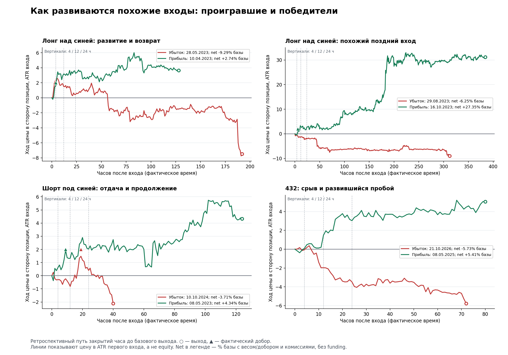

# BTC: исправления funding, добора и пути; плохие сделки, признаки и ранжирование

09.11.2026. Задание: исправить найденные ошибки, повторить проверки, показать старое/новое по каждой затронутой сделке и подробнее исследовать состояние до входа и развитие убытков. Исходный эксперимент: `762ec6f8124cb499a7104fd74544887190d04acb`; предыдущий аудит: `12e03aa`.

Изменения разработаны и проверены в отдельной копии. Живые заявки, параметры, расписания и процессы не менялись, службы не перезапускались. Публичные недостающие бары получены разово для воспроизведения; фоновый сборщик не создавался.

## 1. Главный результат

**Старые 973 сделки воспроизведены полностью.** Время входа и выхода совпало для 653 Binance и 320 Bitstamp; максимальное расхождение со старым CSV менее 0.000051 п.п. базы, то есть округление четырёх десятичных знаков. Теперь поправки сравниваются на одном и том же наборе, а не на другой истории.

**Исправлены:** зависимость funding-признаков от будущего, фиктивные нули до начала истории, перенос будущих выплат в последний час, начало funding добора, порядок стоящего добора перед выходом по close, post-exit MFE/MAE и календарные часы пути. Новые path-метки исключены из признаков моделей.

**250 сделок меняют данные, разметку пути или старый clock денежного учёта.** Расширенное сравнение включает345 строк, если добавить изолированный контрфактический тест basis-ошибки на всех ногах. У95 строк он является единственной причиной включения;47 из них long, к которым старый basis-скрипт вообще не применялся. Это не345 изменившихся опубликованных денежных результатов. Для каждой строки сохранены причины и отдельные флаги actual/counterfactual scope.

| Что изменилось | Сделок | Что это означает |
|---|---:|---|
| Funding 24ч / 7д / 30д на входе | 122 / 134 / 165 | Отсутствующая или недостаточно зрелая история теперь missing; множества перекрываются |
| MFE и отдача | 65 | Исключены post-exit экстремумы целевого выхода |
| MAE | 7 | Исправлено значение или вместо ложной точности возвращён диапазон |
| Порядок ±1 ATR | 10 | Шесть неоднозначных 0.5 заменены missing; четыре post-exit касания +1ATR больше не считаются касаниями позиции |
| Фактическая длительность | 13 | Учтены реальные пропуски часов, а не число строк |
| Усечённый ход через 24 / 72 / 168ч | 2 / 3 / 2 | Горизонт определяется реальным UTC временем |
| Начало funding второй ноги в старой basis-проверке | 118 | Контрфактический ошибочный start исправлен; это не ошибка всех старых базовых PnL |
| Порядок выплаты относительно intrabar add/target | 21 | Отдельная поправка часов денежного учёта |

Важный отрицательный результат: **ошибка пропуска добора на exit-bar не сработала ни в одной из этих 973 сделок**. Она исправлена и воспроизводится/закрывается тестами, но исправление не добавило исторической прибыли. Без funding результаты всех 973 позиций остались прежними.

Новые модели также не выдали готового улучшения: фильтр плохих входов ухудшил результат; фиксированный выходной рейтинг через 24ч тоже ухудшил его. Зато получены конкретные факторы, пары противоположных исходов и понятный предел того, что ими можно предсказать.

## 2. Где посмотреть каждую сделку

Все результаты находятся в `research/btc_feature_repair_20261109/`:

- [Все 973: старое и исправленное](../research/btc_feature_repair_20261109/results/trade_repair_all.csv).
- [250 фактически изменённых данных/часов](../research/btc_feature_repair_20261109/results/trade_repair_actual_affected.csv).
- [Расширенные 345, включая basis-контрфактическую проверку](../research/btc_feature_repair_20261109/results/trade_repair_affected.csv).
- [Исправленная таблица для исследований](../research/btc_feature_repair_20261109/results/trade_table_btc_corrected.csv).
- [Рейтинг до входа для всех 973](../research/btc_feature_repair_20261109/audit_bad_trades_predictions.csv).
- [Ранжирование 8 исходных факторов × 4 типа](../research/btc_feature_repair_20261109/audit_bad_trades_factor_ranking.csv).
- [Ещё 8 осей до входа × 4 типа](../research/btc_feature_repair_20261109/preentry_factor_ranking.csv).
- [Состояния через 4/12/24ч](../research/btc_feature_repair_20261109/progress_landmarks.csv) и [прогнозы продолжения на 24ч](../research/btc_feature_repair_20261109/progress_24h_predictions.csv).
- [Разбор пяти пар до входа](../research/btc_feature_repair_20261109/preentry_review.md) и [развитие позиций](../research/btc_feature_repair_20261109/progress_review.md).

В сравнении есть trade_id, даты, старый опубликованный и старый пересчитанный net, новый net, добор, отдельные funding-clock/basis-поправки, strict coverage, старые/новые funding-признаки, MFE/MAE, границы неопределённости и причины изменения. Разница округления не помечается как эффект исправления.

## 3. Денежный результат: не смешивать разные поправки

Все числа ниже — п.п. фиксированной базы, с прежними комиссиями и весами. Funding оценивается по наблюдённым ставкам Binance с ценой spot на том же часе выплаты, **это price proxy, не actual futures mark**. Это сопоставимый исследовательский ledger, не подтверждение реальных исполнений.

| Binance | n | Без funding: было → стало | Старые записанные часы выплат → исправленные |
|---|---:|---:|---:|
| Лонг над синей | 218 | 406.8092 → 406.8092 | 366.8344 → 366.8098 |
| Шорт под синей | 234 | 135.2925 → 135.2925 | 138.9309 → 138.9477 |
| Шорт под жёлтой | 85 | 42.4057 → 42.4057 | 49.8045 → 49.7955 |
| Система вместе | 537 | **584.5074 → 584.5074** | **555.5698 → 555.5530** |
| 432 | 116 | 326.3217 → 326.3217 | 307.1400 → 307.1400 |

Это закрытые позиции восстановленной таблицы с указанной денежной конвенцией. Не выдавать их за точное повторение округлённых +555.7 `plus.stats` или +307.5 другого исследовательского движка: те сводки могут включать другое окончание/открытую переоценку и next-open цены. Здесь исходный no-funding PnL каждой строки согласован, а funding-clock меняется отдельно.

Старую basis-ошибку «добор получает funding с первого входа» нужно отделять от старой базовой equity. В исправленном коде basis-проверки вторая нога получает свой clock; в сравнении она показана отдельной колонкой `basis_bug_correction_proxy`. Например:

| Вход | Ошибочный basis-net | Правильный net | Поправка |
|---|---:|---:|---:|
| Long 07.07.2026 00:00 | −1.088117 | −0.999595 | +0.088522 |
| Long 02.02.2021 12:00 | +17.123977 | +17.196375 | +0.072398 |
| Short 11.10.2019 12:00 | +1.915144 | +1.848957 | −0.066187 |

Знак поправки зависит от стороны и выплат. Нельзя автоматически считать все исправления улучшением прибыли.

Строгое funding-покрытие есть у **532/653 Binance-позиций**; у Bitstamp-2014–17 соответствующего Binance perp не существовало. Для неподдержанного периода strict funded-net = NaN. Сводка observed-only оставлена для сравнения старой синтетической методики с нулевыми ненаблюдёнными выплатами; она не превращает такую историю в исполнимую perp-торговлю. На проверке 2023+ все 288 позиций имеют полное покрытие по принятой конвенции.

## 4. MFE/MAE: конкретные изменения

Все 39 Binance-часов целевого выхода дополнены минутами. Их агрегаты O/H/L/C точно совпали с часовой историей. Минуты после первого касания исключены. В минуте самого касания порядок экстремумов не выдумывается: используются bounds. В этих 39 сделках ранее достигнутый MAE уже определял глобальное значение, поэтому итоговые extrema оказались определимы в принятой first-touch модели; время экстремума всё равно задаётся разрешением бара, не тиковой точностью.

У Bitstamp: 27 target-выходов, один исполнился на открытии, в четырёх случаях осталась неоднозначность; остальные extrema определяются более ранним путём. Неизвестный MAE теперь None плюс lower/upper, а не уверенное число.

| Вход target-short | MFE старый, ATR | Исправленный |
|---|---:|---:|
| Binance 02.03.2023 08:00 | 4.2471 | **0.8320** |
| Binance 12.06.2025 16:00 | 3.7277 | **1.9324** |
| Bitstamp 17.05.2016 00:00 | 2.5428 | **1.4093** |
| Binance 24.02.2019 20:00 | 1.3022 | **0.5109** |

Это важная поправка к анализу факторов: некоторые прежние «большие MFE» принадлежали уже закрытой позиции. Она не меняет её цену выхода или прибыль автоматически.

Время MFE/MAE сохраняется как интервал; прежнее поле помечено `bar_upper_bound_not_tick_time`. «Ход через 24/72/168ч» по-прежнему усечён базовым выходом, но теперь считает настоящие часы. Если точного часового наблюдения нет — missing, а не соседняя будущая цена.

## 5. Повтор двух находок и funding-кандидата

Старые квантильные правила повторены без нового подбора порогов. Базис 7д: 79 test-сделок, no-funding +26.4391→+27.2634, p=.140. На исправленном funding-ledger +28.0237→+28.7093, p=.149. Преимущество не подтвердилось.

Точечный базис: 79 сделок, +25.3650→+34.7174, p=.020; с исправленным funding +26.9498→+36.2460, p=.019. Он остаётся кандидатом после многократного отбора, с неровными корзинами 10/30/33/4/2, а не готовым монотонным законом размера.

Цена−RSI для target-short: прежние суммы +18.7438→+25.4599 и Bitstamp +6.3918→+11.4405 сохраняются. Перестановки со своим фиксированным seed дают .192/.285; отличие от .211/.266 предыдущего аудита обусловлено seed/999 симуляциями, не новыми деньгами. Ни один вариант этим не подтверждён.

**После исправления funding 7д изменился состав наблюдений.** Вместо 117/117 с фиктивными ранними нулями — 90/91 действительно доступных сделок. На новом late split no-funding +21.4144→+30.3086, p=.020; исправленный funded +23.3673→+32.1908, p=.014. Это полезная новая зацепка. Но одновременно изменились population, train/test boundary и квантильные пороги; нельзя приписать весь эффект «исправленному начислению funding» или назвать его независимым подтверждением.

Точечная чувствительность, без новых моделей/порогового поиска:

| Funding7д, short-blue | Train/test | База funded | Размер по пятым | Δ | IID p | Circular shift | Месячный95% интервал Δ |
|---|---:|---:|---:|---:|---:|---:|---|
| Половины реально доступных | 90/91 | 23.3673 | 32.1908 | +8.8235 | .014 | .0440 | [−1.55; +20.32] |
| Календарь: train до2023, test2023+ | 94/87 | 24.6584 | 35.7296 | **+11.0712** | .010 | .0115 | [+2.23; +21.78] |

На half90/91 средний множитель .8819, поэтому прибавка не объясняется простым увеличением среднего размера. После удаления трёх наибольших положительных вкладов Δ остаётся+2.504; на календарном94/87 +4.751. Это исследовательская robustness, не selection-adjusted подтверждение. Calendar split и половины не независимые эксперименты.

**Причина изменения headline проверена:**53 фиктивных нуля ушли из прежнего train,26 прежних test-сделок перешли в новый train. На точно тех же90/91 и94/87 ID старые и исправленные значения дают одинаковые квантильные назначения и деньги. Значит появление красивой headline-суммы относится главным образом к иной population/split, а не к внезапно возникшим новым значениям-предикторам. На старой границе с новым доступным train64/test117 абсолютная funded-сумма, наоборот,55.09→50.16; средний множитель там .7564, поэтому это также не доказательство бесполезной аллокации — одинаковый постоянный размер дал бы41.67. Все семь контролей, риск-нормировка как грубая диагностика и оговорки сохранены в [funding_candidate_review.md](../research/btc_feature_repair_20261109/funding_candidate_review.md).

Для трёх соседних funding/basis проверок и всей предыдущей истории отбора остаётся поправка на семейство; выбирать наименьший p нельзя. На месячном half-интервале ноль включён. Перспективная зацепка сохранена, доказанная прибыльная политика не объявлена.

### Проверка количества, просадки и экспозиции того же кандидата

Для **той же календарной94/87 политики**, без нового подбора, выполнен денежный replay количества каждой ноги. Размер меняется только у87 short-blue; сигналы, доборы, выходы и остальные201 сделки неизменны.

| Все288 закрытых test-сделок, 2023–2026 | База | Funding sizing |
|---|---:|---:|
| Net с funding, % фиксированной базы | 331.6723 | **342.7435** |
| MTM max drawdown, п.п. базы | −25.8803 | **−24.9659** |
| Средний gross на наблюдаемых часовых close, % базы | 59.6335 | 59.2408 |
| Максимальный gross на close, % базы | 334.1405 | 334.1405 |
| Худший месяц, п.п. базы | −14.1144 | −12.1012 |
| ES худших5% часовых изменений, п.п. базы | −1.0388 | −1.0363 |

Прирост+11.0712 сохраняется при немного меньшем среднем gross и одинаковом пике; просадка тоже немного лучше. Конечная equity совпала с суммой strict cashflows с погрешностью<1e−9. Постфактум риск не масштабировали. Это полезный положительный исторический результат, который стоит усиливать отдельной проверкой, а не отбрасывать.

Ограничения: **closed cohort**, позиции, ещё открытые на конце исходного списка, исключены; это не полный живой счёт. Одна часовая цена24.03.2023 14:00 неизвестна: DD/gross рассчитаны на наблюдённых close, часовой ES исключает переход через дыру. Intrahour пики риска, фактические маржинальные ограничения и actual mark не восстановлены. Отбор истории/семейства проверок тем самым не исправлен. Подробности и все часы — в [funding_sizing_equity.md](../research/btc_feature_repair_20261109/funding_sizing_equity.md).

## 6. Как определены плохие сделки и построен рейтинг до входа

«Тяжёлый убыток» — результат <= q20 своего типа на зрелых Binance-сделках 2018–22. Порог по типам: long −2.1453, short-blue −1.4617, target-short −1.7734, 432 −3.5273 п.п. Это операционная метка размера потери, не синоним ошибочного решения при входе.

Сохранён score для всех 973 сделок. Одна заранее выбранная L2-логистика C=.1 использует 8 entry-only полей и intercept типа: ADX, ER24, пересечения З/Ж30д, ATR%, направленные расстояние/наклон зелёной, RSI и ход7д. Imputer/scaler/границы только train; future path/funding-нули/итог не входят в X. Порог исключения q80 train score по типу. Это историческая временная проверка на уже изучавшихся годах, не новый независимый forward.

| Проверка 2023+ | Было | Статический пропуск высокого риска | Изменение |
|---|---:|---:|---:|
| Все 288 сделок | +344.25 | +183.68 | **−160.57** |
| Long над синей | +163.79 | +80.28 | −83.51 |
| Short под синей | +22.92 | +18.68 | −4.24 |
| Target-short | +18.74 | +9.92 | −8.83 |
| 432 | +138.80 | +74.80 | −64.00 |

Рейтинг распознал 18/41 тяжёлых потерь, но удалил 109/288 позиций, включая 13 из 20 крупнейших победителей по четырём типам. Сохранил 102.57 потерь, уничтожил 263.14 положительной прибыли. AUC .578 не сделала его полезным фильтром. Общие коэффициенты также плохо учитывают противоположное поведение разных типов.

Это статическое маскирование старого списка, не новый автомат: пропущенные входы изменили бы последующие блокировки/сигналы. Внедрять рейтинг как запрет входа нельзя на основании этой проверки.

## 7. Какие признаки заслуживают внимания

Ранжирование выполнено по train; направление на test не переворачивалось. Это описательные исследования: 32 исходных сочетания «8 факторов × 4 типа», ещё 32 новых предвходных и 32 факторов развития. Их нельзя считать независимыми подтверждениями и выбирать красивый test-показатель без поправки на весь просмотр.

| Тип / вопрос | Конкретное наблюдение | Практический смысл |
|---|---|---|
| Long: поздний вход | Большое расстояние до зелёной: AUC тяжёлого убытка train .656 → test .624; быстрый наклон зелёной .624→.668 | Отмечать перегрев/цену догоняющего входа, но не отрезать автоматически все сильные тренды |
| Short-blue: импульс уже прошёл | Направленный ход12ч median 2.508 ATR у тяжёлых против 1.605 у остальных; test AUC .769 | Исследовать вход после израсходованного импульса и цену ожидания отката |
| Short-blue: ускорение геометрии | ER-change12ч .300 против .122, distance-change12ч 1.939 против 1.305 ATR | Эти признаки описывают близкую ось; это не три независимых подтверждения |
| Target-short: смена ускорения | Acceleration train AUC .738 → test .698, широкий интервал [.492;.863] | Контртрендовый short требует собственной логики, не общего трендового score |
| 432: откат внутри пробоя | Pre-entry pullback24ч median .552 против .337 ATR; test AUC .716 | Кандидат «качество пробоя», но всего 5 тяжёлых test-исходов; ранг выбирался train |
| Поток спота | Signed taker4ч test AUC около .51–.55 по типам, интервалы через .5 | Сам по себе знак покупок/продаж слаб; полезнее проверять реакцию цены на поток |
| 432: универсальная перекупленность | Старый ход7д .672→.182; новый acceleration .596→.302 | Знак риска нестабилен; нельзя переносить long/short-эвристику на 432 |

Восемь новых осей: move12ч/ATR; ускорение последних4ч относительно предыдущих4ч; откат от экстремума24ч; изменение расстояния до зелёной12ч; изменение ER24 за12ч; V4ч к прошлой30д медиане; направленная δ4ч; направленная δ4ч−δ24ч. Все часы реальные, окна требуют coverage, пропуски не нулевые. Цены входа 653/653 и пять prefix-проверок согласованы.

## 8. Что было до плохих входов: не только снимок индикаторов

Построены −24/−12/−4/0ч для пяти заранее выбранных пар: 40 точек цен, линий, объёма и spot delta. Пары выбраны после исходов для объяснения, не являются случайным контрольным экспериментом.

**Long 29.08.2023, −6.2468 против 16.10.2023, +27.3528.** До плохого входа: почти 5.831 ATR за последние12ч, объём перед ним вырос примерно до9× нормы и к входу был6.25×. Победитель прошёл3.799 ATR за12ч, объём1.34×→4.27×; к входу покупательская δ4ч .0879 против .0341 у проигравшего. Это различие последовательности импульса, а не просто «RSI высокий». Нельзя установить новостную причину без отдельного источника.

**Long 28.05.2023, −9.2940 против 10.04.2023, +2.7405.** У входа почти одинаковые δ4ч .0608/.0657 и V/reference 1.823/1.837. Сам поток их не разделил. Проигравший действительно сначала развился; проблема затем возникла в удержании и второй ноге.

**Short-blue 10.10.2024, −3.7090 против 08.05.2023, +4.3352.** Плохой short входил после уже прошедшего быстрого падения; поток продавцов был у обеих ситуаций. Различие нужно искать в зрелости импульса и реакции после входа, а не в механическом «дельта отрицательна».

**Target-short 12.07.2023, −4.9973 против 12.10.2026, +0.5445.** Прибыльный аналог имел положительный buy-flow на входе. Универсальный запрет short при покупателях не следует даже из этой пары.

**432 21.10.2026, −5.7346 против 08.05.2025, +5.4064.** До входа обе цены и направленный импульс похожи; сильное расхождение проявилось в развитии пробоя. Одна дельта или один ADX этого заранее не доказали.

## 9. Как развивались сделки и что означает риск сейчас

Для каждой ещё открытой позиции сохранено состояние через4/12/24 календарных часа. Использованы только уже завершённые часы и реально действующие ноги. На Binance получилось632/533/454 состояния, на Bitstamp310/248/213; отдельные13/6/2 строки всех площадок исключены из-за реальных часовых дыр. Поздние значения не подставлены.

| Конкретный вход | Net на4ч | На12ч | На24ч | Финальный net |
|---|---:|---:|---:|---:|
| Long 28.05.2023 | +1.0648 | +0.3963 | −0.7520 | −9.2940 |
| Long 16.10.2023 | −0.2979 | +1.5980 | +1.4335 | +27.3528 |
| 432 21.10.2026 | −0.1956 | −2.0449 | −3.5147 | −5.7346 |
| 432 18.08.2026 | −0.4624 | −0.9439 | +5.5635 | +20.6393 |

Long28May к12ч имел MFE3.638 ATR; к24ч позиция уже была отрицательной, хотя цена почти не ушла ниже первого входа. **Добор выше первой цены меняет экономику позиции:** MAE от первого входа не равен убытку всего набора.

На4ч состояние «MFE<1ATR и текущий ход<=−1ATR» включало9 будущих убытков из11, но дальнейшее удержание суммарно добавило **+16.41** относительно закрытия сейчас. На12ч13/15 убыточных, а удержание всё ещё добавило **+9.67**. На24ч14/16 убыточных, но будущая добавка всего −0.3304: основная потеря уже состоялась. Закрытие сейчас не возвращает прошлый убыток.

Развитые к24ч позиции с откатом>=1ATR содержали17 проигравших из44, однако дальнейшее удержание добавило+33.95. Поэтому правильная цель выхода — **будущий net HOLD минус net CLOSE сейчас**, с обеими сторонами расходов/funding.

Линии показывают направленное движение цены в ATR первого входа, не equity; net в легендах учитывает веса и добор, без funding. Это ретроспективный график, не видимый на входе будущий путь.

## 10. Одна проверка рейтинга удержания на24ч

Ridge alpha10 без clipping y; type offsets и восемь state-признаков: net закрытия сейчас, достигнутые MFE/MAE, ATRcurrent/ATRentry, направленное расстояние до зелёной, ER24, направленный наклон зелёной, действующий размер. Train259, test195 достигших24ч; обучающие исходы закрыты до2023. Порог EXIT: predicted future increment<0. На4/12ч модели не подбирались.

Из195 состояний выбрано7 выходов:4 полезных,3 вредных. Сохранено4.5458, уничтожено15.4763 будущей прибыли. Без funding Δ **−10.9305**, месячный исследовательский интервал [−42.07;+7.50]. На всех288 test-сделках +344.2519→+333.3214. Один short16.08.2023 дал почти весь отрицательный эффект: модель закрыла+1.4464 вместо последующего+15.5574.

После правильного funding для **тех же замороженных scores и семи действий**, без нового fit: база **+331.6723 → +320.7047**, Δ **−10.9676**. Все288 final и195 close-now альтернатив имеют strict coverage по принятой spot-proxy модели. Это не улучшение.

Это оценка разового overlay на прежних позициях. Новый выход разрешил бы новые входы; полноценный автомат с ними здесь не моделировался. Test годы уже изучались, числа не являются независимым prospective доказательством.

## 11. Более конкретные улучшения: что теперь имеет смысл делать

Ниже — готовые исследовательские спецификации, с основанием и проверяемой целью. Они не объявлены прибыльными. Отдельно помечены уже проверенные идеи, чтобы их не предлагать заново под другим названием.

| Приоритет | Предложение / артефакт | Основание и критерий |
|---|---|---|
| 1 | **Четыре отдельные трактовки состояния** с частичным общим shrinkage | Общий pooled loss-score уничтожил тренды; у432 некоторые направления противоположны long. Проверять добавочную net-пользу взаимодействия type×ось, не AUC вообще |
| 1 | **Два рейтинга: тяжёлый риск и экономический потенциал хвоста** | 18 пойманных тяжёлых потерь не окупили уничтоженную прибыль. Ранг risk не должен автоматически означать WAIT; сравнивать ожидаемый net и его неопределённость |
| 1 | **Карточка зрелости импульса до входа:** move12ч, acceleration4ч, ER-change, distance-change | Для short-blue большой уже случившийся ход связан с тяжёлыми исходами. Считать один трендовый блок, не четыре голоса за запрет |
| 1 | **Funding/basis как один блок размера**, а не знак входа | После очистки нулей funding7д стал интереснее. Следующий тест — одна зафиксированная политика на общем календаре, правильный ledger и matched exposure |
| 1 | **Отдельная оценка добора против сохранения ядра** | Long28May показывает, что price-MAE почти0 может сочетаться с net-убытком после второй ноги. Цель: Δnet ADD−NO ADD с clock/qty каждой ноги; не вырезать само трендовое ядро |
| 1 | **Рейтинг текущей позиции относительно VWAP/всех ног** | Добавить текущий net, расстояние до безубытка после расходов, вес и долю риска второй ноги. MFE/MAE первого входа оставить отдельной геометрией |
| 1 | **Цель удержания HOLD−CLOSE с обоими cashflows** | Много финальных убытков уже потеряно к моменту решения. Новая модель должна оценивать будущую добавку, а не заново предсказывать знак всего PnL |
| 2 | **Реакция цены на поток вместо одного знака delta** | δ4ч почти не отделила тяжёлые потери. Проверить absorption/exhaustion: одинаковый поток при уменьшающемся продвижении цены; denominator=0/missing не домысливать |
| 2 | **Последовательность сжатие→всплеск→удержание**, 3–4 наблюдения до входа | Пара August/October различается траекторией объёма и времени импульса. Требовать улучшения над snapshot baseline и учёт latency |
| 2 | **Уверенность решения и право удержать базу** | Модель24ч закрывала тренд по малому отрицательному прогнозу. Заранее определить abstain/сжатие к HOLD при широком интервале, а не подбирать новый порог на этих7 сделках |
| 2 | **Разделить “не началось”, “отдали развитое”, “дорогой добор”, “стоимость удержания”** | Это разные механизмы потери. Метки состояния — только уже наблюдённые; истинные будущие классы не входят в X |
| 2 | **Календарь события + ETH/BTC relative strength** как два компактных внешних блока | Их смысл отличается от десятков расстояний до тех же линий. Calendar announced/revised time и source coverage обязательны; сравнение на одних датах |
| 2 | **Out-of-time calibration и drift-контроль score** | Train q80 выкинул38% test вместо20%. Сохранять support/age/rank drift; не перенастраивать квантили на будущих исходах |
| 2 | **Одинаковый риск и MTM для полной политики** | Статическая фильтрация/overlay уменьшают exposure и меняют разрешённые входы. Финальный вывод только после replay всех заявок, новых входов, открытого остатка и funding |
| 3 | **Actual perp mark/исполнения вместо spot-proxy денежного завершения** | Текущий replay честно согласован, но не actual futures execution. Подменять его реальной доходностью нельзя; это отдельный слой проверки исполнения |

Уже проверено и **не улучшило**: одна общая loss-логистика на8 входных признаках; одна Ridge exit-модель24ч; одна лишь высокая доля финальных убытков как основание раннего выхода; один знак spot delta как самостоятельное сильное различие. Повторять эти идеи с новыми словами недостаточно.

## 12. Код, тесты, данные и следующий конкретный шаг

Изменены только необходимые вычислительные части: `engine.py` (chronology), `features.py` (funding records/windows и path wrapper), новый `excursions.py`, `run.feature_rows` (тип выхода), `entry_rules.prep`, `basis_check_1109.with_funding`, `trade_table` (clock/coverage ног), `trade_scan.OUTCOME`. Обученная M2 и feature_ref не перезаписывались.

**83 целевых теста прошли:**30 прежних,20 funding,14 path и19 денежного replay. Дополнительно выполнены полное согласование973 позиций, пять raw-prefix проверок pre-entry, четыре as-of/qty проверки landmark, два synthetic-проверочных сценария MTM количества и сравнение всех39 Binance target-часов с минутами. Весь исторический suite1584 здесь не перезапускался; эти83 относятся к изменённым частям.

Данные найдены в дополнительных локальных копиях после предыдущего аудита; это снимает прежнее ограничение “нет ряда для полного replay”. Чтобы закрыть концы, разово получены36 spot H1,24 недостающих часа spot1m и5 funding выплат. Ещё15 target-часов взяты локально. Использован официальный [Binance market-data-only endpoint](https://developers.binance.com/en/docs/products/spot/rest-api); исходные raw не переписывались. Полные source hashes, URL, retrieved_at и QA сохранены в manifest. Единственное расхождение двух локальных minute-источников — незавершённая frozen-минута07.05.2026 11:45; она не подменялась молча.

Четыре неоднозначных Bitstamp path, actual futures mark/исполнение и публикационные vintages внешних рядов остаются ограничениями. Исправления не доказывают новый edge и не устраняют многократный отбор старой истории. No-funding label у entry/progression fit сохранён; funded-оценка exit-политики выполнена отдельно без смены forecasts. Вне выбранных пользователем funding/добор/path исправлений остаются замечания предыдущего аудита о NaN-ранге ATR, missing→0 CoinGlass и отдельной maker-схеме; её два прежних контрпримера не объявляются исправленными этим пакетом.

**Следующий рекомендуемый эксперимент:** одна заранее зафиксированная funding7д-политика размера для short-blue на общем календаре, с постоянным правилом входа/выхода и одинаковым риском. У неё уже есть конкретная положительная исследовательская зацепка. Артефакт — протокол с неизменными source snapshot, train cutoff/квантилями, primary Δnet, ограничениями риска и неприкосновенным будущим периодом; затем полный replay/forward-журнал всех решений и сравнение с постоянным размером. Управление второй ногой проверять следующим отдельным экспериментом, чтобы не смешать две причины изменения. Новый эксперимент здесь не выдаётся за уже подтверждённое улучшение.
