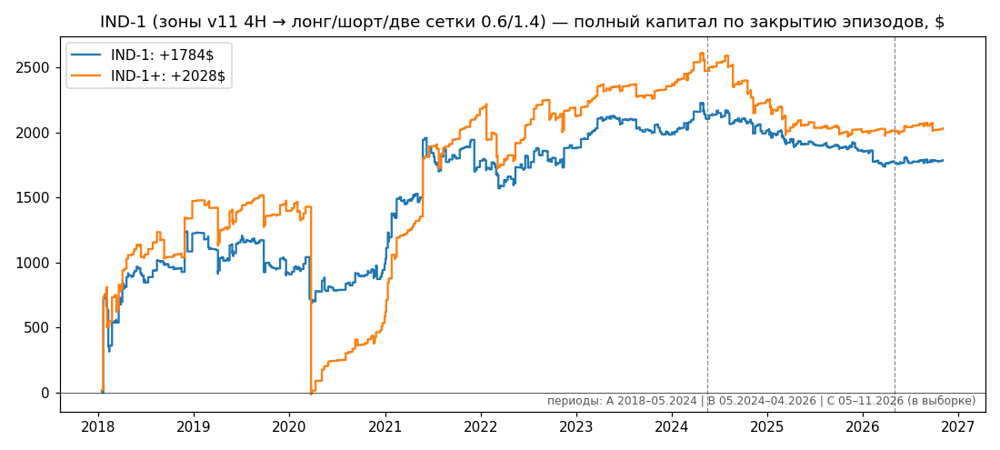

# Ответ на пакет GPT 29.10–02.11: режимы BTC, чтение графиков оператора и правила сеток

**02.11.2026, Claude. Ветка `alexey/mac-2026-05-29`.** Разобраны 9 документов `docs/WEEX_GPT_*` (главный —
`WEEX_GPT_MARKET_REGIMES_AND_GRID_RULES_2026-11-02.md`, к нему `…MA_SETTINGS…`, `…MACRO…` и шесть файлов 29.10).
Правила записаны и закоммичены **до первого прогона**: `research/market_regimes_20261102/PREREG.md`, коммит
`f24a9b7`. Скрипты и результаты — `research/market_regimes_20261102/` (код GPT из docs не запускался, только читался).
Живая торговля, конфиги и торговый код не менялись.

## 0. Коротко

1. **Режимные сетки по средним оператора — нет.** Ни одно из 22 правил (11 прямых, 8 перевёрнутых, 3 «выключать в
   плюсе») не прошло все ворота. Лонг-сетка «в росте» (зона 4H = +1) не лучше случайной лонг-сетки той же длины:
   ранг 0.59. Шорт-сетка «в падении»: +$1 020 за 2018–04.2026, но 2024–26 −$372; ранг 0.10.
2. **Флет по его же формуле — нет.** Правило «зона 0 и сжатие TEMA < 0.6» дало −$509, ранг 0.84 — хуже случайных
   эпизодов. Глазом июль–август был флетом: две сетки в этом окне +$110. Но формула поймала там 2 эпизода на 92 часа
   (−$1.2). RANGE v0 GPT за 8.8 лет включался 11 раз, итог +$7.6, ранг 0.52.
3. **Перевёрнутое правило — сильнейший результат, но не кандидат.** Это **лонг**-сетка, пока 4H зона = −1, с
   закрытием на первом часовом развороте вверх (D3-inv). За 2018–04.2026 она дала **+$3 900, ранг 0.001**:
   - обе половины A и B в плюсе;
   - все 5 соседей в плюсе;
   - ДИ на эпизод [+2.3; +23.1];
   - издержки ×2 — +$3 480.

   Но в мае–ноябре 2026 она дала −$92: один эпизод в каскаде 1–6 июня −$123. Свежий период в минусе, поэтому
   ворота не пройдены. На ETH те же правила дали +$1 878, но ранг 0.30 — не лучше случайных лонг-сеток. Значит,
   эффект BTC — скорее особенность одной монеты или удача среди 22 проверок, а не механизм. Это прямо против
   чтения «в падении лонг не открывать», но и опоры для живого правила не даёт.
4. **CoinGlass/TV описывают текущий час, а вперёд не видят.**
   - В тот же час: поток тейкеров r = +0.51, ликвидации L−S r = −0.48.
   - На 24 ч вперёд — ноль: значимо на 0–2 монетах из 10.
   - Все шесть его чтений (K1–K6) не прошли контроль: ранги 0.16–0.63, значимо на 0–2 монетах из 10.
5. **«82k».**
   - **В этом случае прав оператор.** С касания EMA200 4H 08.10 шорт-сетка до сегодня дала бы +$57. Лонг-сетка до
     выключения 30.10 — −$14 (сетка 0.6/1.4, $100 на ордер).
   - **Как правило — нет.** За 2018–2026 было 92 касания, ранг 0.285. Шорт-правило T1: 2024–26 −$144.
   - Запрет прежнего Claude тоже не опирался на доказательство: выключатель SMA100 контроль по отрезкам не проходил
     (CLAUDE.md, ранги 0.47 / 0.18).
6. **Сейчас** (02.11 14:49 UTC, BTC 77 850).
   - 4H зона 0, цена ниже EMA200 4H (80 871) и выше SMA100 (76 463).
   - IND-1 — «ожидание».
   - Из такого состояния за 30 дней в истории (37 раз): закрытие дня ниже 74 934 было в 51% случаев, возврат выше
     80 871 — в 97%. Медиана +1.6%, 10–90% от −16% до +26%. Это частоты прошлого, а не прогноз.

## 1. Как проверено

- **Цена.** Минутки Binance spot BTCUSDT 17.08.2017–02.11.2026 (копия снимка):
  - sha256 `63ada759…` (2017–2024) и `8760f635…` (2y);
  - фандинг — фактические выплаты Binance (`3d2fbf64…`);
  - 8 632 пропущенные минуты 2017–2024 — остановки самой Binance (08.02.2018 — 2 011 мин и т.п.). Минуты не
    дорисовывались: в сетке это пауза.
- **Средние.** Как в индикаторах оператора (`MA_SETTINGS` GPT, §2–3):
  - зелёная/жёлтая/красная = TEMA50/100/200;
  - голубая = EMA200;
  - зона v11 — 3 бара подтверждения;
  - дневная SMA100 — как в `engine.regime_up`.

  Мои зоны на spot совпали по времени со всеми событиями таблицы GPT на Bybit: 07.05 20:00 4H→−1, 07.05 21:00 1H→−1,
  07.06 12:00 4H→0, 20.08 12:00 4H→+1.
- **Сетка.** Механика `research/weex/regime_grid.run`: шаг от крайнего открытого лота, тейк каждого лота.
  - Ядро на C, `gridk.c`, сверено с питоном один в один (`validate_kernel.py`): −83.765513 / +629.135083 /
    +129.236432, разница < 1e-12.
  - Настройка 0.6/1.4, ордер $100, потолок $6 000 на сторону; у «двух сеток» — $3 000 + $3 000.
  - Мейкер 0.016%, выход остатка тейкер 0.048% + 0.02%. Возвратов нет.
  - Итог — полный капитал: тейки + выход остатка − комиссии ± фандинг.
- **Периоды.**
  - **A** 2018–15.05.2024 — новый для этих правил.
  - **B** 15.05.2024–01.05.2026.
  - **C** 01.05–02.11.2026 — это период, который оператор читал по скриншотам. Он в выборке.
- **Контроль.** Те же сетки в случайные моменты той же длительности и стороны, в том же периоде. 999 повторов,
  ранг `(k+1)/(n+1)`.
- **Ворота (из PREREG).** Кандидат — только если выполнено всё:
  1. плюс в A, B и C и в каждой половине A и B;
  2. ранг на A∪B ≤ 0.05;
  3. все 5 соседей в плюсе: 0.6/1.4, 0.4/1.0, 0.8/1.65, 0.6/1.0, 0.6/2.0;
  4. 95% ДИ среднего на эпизод не содержит 0.

## 2. GPT пункт за пунктом

| # | Утверждение GPT | Вердикт | Чем проверено |
|---|---|---|---|
| 1 | Участки: 12–22 мая −7.57%, 31.05–06.06 −17.61%, 16.06–01.07 −9.48%, 19–25.08 +21.35% | **Верно** (spot −7.59 / −17.59 / −9.51 / +21.34) | `segments.py` |
| 2 | Первая отрицательная выплата фандинга 04.06 16:00 не остановила падение: −3.42% за 24 ч | **Верно** (−3.41%); как правило «фандинг в минус → дно» не работает и на 10 монетах: K4, ранг 0.33 | `segments.py`, `cg_claims.py` |
| 3 | Начало мая: OI падает, доля лонг-аккаунтов растёт, топы около 41% | **Верно** и на агрегате CoinGlass: OI −11.96% за 6→9 мая, L/S аккаунтов 0.51→0.73, L/S топ-позиций 0.75→0.70 | `segments.py` |
| 4 | Зелёные столбики не доказывают преобладание покупок на падении (Binance 49.32% / 48.66%) | **Верно**: агрегат CoinGlass 6–9 мая 50.52% покупок, 31.05–06.06 48.69% | `segments.py` |
| 5 | Дневная SMA100 на 19.08 = 66 421, смена по закрытию 19.08 (69 334.79 > 66 296.98) | **Верно**, режим вверх с 20.08 | `segments.py` |
| 6 | «Истории WI2, ликвидаций и OI CoinGlass после 11 мая нет» | **Неверно для нас**: экспорт 01.05–28.10 по 10 монетам есть (`research/coinglass_compare/data`), на нём проверены K1–K6 | `cg_claims.py` |
| 7 | «85k в данных не подтверждается» | **Устарело**: данные GPT кончались 15.09, а максимум 87 396 был 21.09. Эпизод «82k» — касание EMA200 4H 08.10 16:00 (81 657) | `look_oct.py`, `segments.py` |
| 8 | Цена 6 ч ↑ / поток 6 ч ↓ → 65.2% снижений (15 из 23) | GPT сам не назвал это эджем. **На 2 годах BTC эффекта нет**: 49.3% из 146 (Wilson 41–57%) | `cg_claims.py` (лента Binance UM 15.05.2024–14.10.2026) |
| 9 | Поток и цена связаны одновременно (0.46–0.67), опережающая связь нестабильна | **Верно**: по 10 монетам одновременно 0.51, вперёд на 24 ч 0.05, значимо 0/10 | `cg_claims.py` |
| 10 | Зона 0 ≠ флет, две сетки по `zone == 0` не включать | **Подтверждено бэктестом**: F1 −$509 (ранг 0.84), F1b −$173 (0.75) | `regime_rules.py` |
| 11 | 16.06–01.07: 4H выше красной в 90.63% баров, зоны −1 нет | **Верно** (90.62%, 0%) | `segments.py` |
| 12 | Спецификация RANGE v0 (§8.2) | Проверил как записано. За 8.8 года 11 запусков, 13 дней в рынке, +$7.6, ранг 0.52. Правило почти не включается; эджа нет | `regime_rules.py` F2 |
| 13 | «Выключать только в плюсе» недопустимо | **GPT прав**: вариант «в плюсе» дал ранг 0.19, B −$508, просадку −$1 532 против −$558 у обычного | `ind1.py` |
| 14 | Ранний выход из шорта до смены дневной SMA — обоснованная гипотеза | Шорт с ранней фиксацией по 1H (D3) дал −$468 на A∪B, ранг 0.50: **не помогло**. Сильным оказался перевёрнутый вариант (раздел 5) | `regime_rules.py` |
| 15 | «Выше SMA нельзя закрывать лонг и шортить» не следует из данных | **Согласен, что запрет не доказан.** Но и шорт на касании EMA200 4H (T1) не доказан: A +$252, B −$144, C −$25, ранг 0.31 | `regime_rules.py` T1 |
| 16 | Макро: BTC–S&P +0.375, золото +0.526, опережения нет | **Не пересчитывал** (нужна выгрузка Yahoo). Вывод «контекст, не сигнал» нашим замерам не противоречит; в правила не включал | — |
| 17 | Прототипы 29.10: шесть окон, 181 час, итоги $1–30 | Выборка мала, это не доказательство; GPT пишет это сам. Здесь та же идея проверена на 8.8 годах | разделы 5–6 |
| 18 | Пять дефектов учёта 29.10 (P1×3, P2×2) | **Все пять подтверждены** чтением текущего кода (раздел 8) | — |

## 3. Участки: чтение оператора и что показали данные

CoinGlass — агрегат по биржам (экспорт 1h), цена — Binance spot. «4H ниже красной» — доля закрытий 4H ниже TEMA200.

| Участок | Чтение оператора | Что в данных | Вердикт |
|---|---|---|---|
| 6–9 мая | Пробой красной вниз на часе, ретест снизу; агрессивные покупки на всём падении; смена фандинга | Пробой 06.05 23:00, ретест 07.05 08:00, зона 1H −1 с 21:00. Покупки тейкеров 50.52%, плюсовая дельта в 50% часов. Фандинг < 0 в 56% часов. OI −12%; толпа 0.51→0.73 в лонг, топы 0.75→0.70. Итог −0.28%: минимум 79 181, 10.05 снова 82.2k | Пробой и ретест — **да**. «Агрессивные покупки» — **нет**, баланс. Фандинг — **да**. Как сигнал «покупки на падении → вверх» (K1): ранг 0.51 на 10 монетах; на BTC за 2 года первая половина +3.4%, вторая −1.2% — неустойчиво |
| 10–13 мая | Продажи на росте, ликвидации лонгов | Покупки 49.76% (продажи чуть больше), ликвидации лонгов $206M против $136M шортов. 4H ниже красной 96%, цена −1.69% | Описание **верно**. Как сигнал: K2 (продажи на росте → вниз) ранг 0.63; K5 (ликвидации лонгов на росте → вниз) 0.19; 0/10 монет |
| 12–22 мая | Ниже жёлтой на 4H и голубой на 1H; киты в шортах; в стакане продажи | 4H ниже жёлтой 83% (не всё время), ниже красной 100%, 1H ниже EMA200 80%. WI2 13→−44 (да). L/S топ-позиций 0.77→1.10 — топы **в лонг**. Стакан: среднее bid−ask −204, но bid > ask в 51% часов. Ликвидации лонгов $909M против $230M. Цена −7.6% | Структура — **да**. «Киты в шортах» — по WI2 да, по топ-позициям Binance **нет**. Стакан — смешанно. Сигнал K3: на BTC −0.54% за 72 ч против +0.12% (ранг 0.12), по 10 монетам 0.16 — не доказано |
| 31 мая–6 июня | Шорт по нисходящим средним; 4 июня смена фандинга = фиксация шортов | −17.6%, 4H ниже красной и EMA200 100%. Первая отрицательная выплата 04.06 16:00, после неё ещё −3.41%; дно 59 131 — 05.06. Стакан bid > ask (+236), но исполненные покупки 48.7% | Падение и шорт — **да**. «Смена фандинга = дно» — **нет**: K4 ранг 0.33 |
| 7–15 июня | До 11 июня покупки в стакане = закрытие шортов | +8.9%. Ликвидации **шортов** $746M против $299M лонгов — шорты закрывались принудительно. WI2 −92→−19. Стакан при этом с перевесом **продаж** (−407), исполненные покупки 50.97% | Закрытие шортов — **да**, через ликвидации. Но «покупки в стакане» были во время падения (31.05–06.06), а на отскоке стакан был продажный |
| 16 июня–1 июля | (Оператор относит к флету до августа) | −9.5%. Зона v11: −1 в 0% баров, 4H выше красной 91%. Его же индикатор шорта не дал | **Не флет** — GPT прав. Две сетки всё окно +$52: шорт +$74, лонг −$21 |
| 2 июля–15 августа | Флет вокруг синей, средние сжаты и пересекаются — «идеально для двух сеток»; ликвидации с обеих сторон; киты против толпы | Диапазон 59.6–67.0k (12%), +5.1%. 4H ниже EMA200 52% — вокруг синей. Ликвидации L $1 279M ≈ S $1 380M. WI2 около −65, толпа L/S 1.85→2.03 — расхождение есть. Но сжатие < 0.6 только в 16% баров, зона 0 — в 49% | Глазом — **да**: две сетки в окне +$110. Формулой — **нет**: F1 поймал 2 эпизода, −$1.2; на 8 годах F1 −$509. «Ликвидации с обеих сторон + расхождение → флет» (K6): ранг 0.40 |
| 19–25 августа | Стоп шортам на пересечении голубой ~66k, дальше рост | SMA100 66 421. Час 15:00 закрылся на 65 900, 16:00 — на 68 523: стоп «по закрытию часа над 66k» исполнился бы около 68.5k. Ликвидации шортов $2.9 млрд против $0.54 млрд у лонгов, +21.3% | **Да**: шорты надо было останавливать. Дневное правило переключилось только 20.08 00:00 |
| 15–21 сен | Отскок от 75k, рост до 85k | Минимум 74 968 (15.09), максимум **87 396** (21.09), ликвидации шортов $984M против $348M | **Да** (рост до 87.4k) |
| 08–28 окт | Касание синей на 82k: закрыть лонги и открыть шорт; запрет Claude «до 76k» — ошибка | Первое касание EMA200 4H сверху — 08.10 16:00 (линия 81 657, цена 81 038). Три недели вокруг неё, максимум 84 898 (21.10), слом 29.10, минимум 76 326 (30.10). Сетки с касания: шорт до сегодня +$57.0 (41 тейк, остаток ≈ 0), лонг до 30.10 −$13.7 (мешок −$54) | **В этом случае прав оператор**: на сетке $100/ордер разница ≈ $71. Как правило — **нет** (раздел 5, T1 и K7) |

## 4. CoinGlass и TradingView: что работает, что нет

Связь факторов с ценой по 10 монетам (01.05–28.10.2026). «Одновременно» — тот же час. «Вперёд 24 ч» — сумма за 24 ч
против следующих 24 ч, срезы раз в сутки без перекрытия, медиана по монетам. «Значимо» — |r| > 2/√N.

| Фактор | Одновременно | Вперёд 24 ч | Значимо вперёд |
|---|---:|---:|---:|
| Поток тейкеров (агрессор) | **+0.507** | +0.054 | 0/10 |
| Ликвидации L−S (знак проверен: лонг-ликвидации — падающие часы) | **−0.476** | −0.039 | 0/10 |
| Δ OI | +0.185 | +0.005 | 2/10 |
| Фандинг | +0.062 | +0.025 | 1/10 |
| Стакан bid−ask | +0.015 | +0.033 | 1/10 |
| WI2 (изменение) | −0.009 | +0.023 | 0/10 |
| L/S аккаунтов (изменение) | +0.003 | +0.011 | 0/10 |
| L/S топ-позиций (изменение) | −0.004 | +0.033 | 0/10 |

Чтения оператора как событие против случайных часов той же монеты. Сводка по монетам — общий сдвиг всех событий
(монеты не независимы). Исход — 72 ч.

| Код | Чтение | Событий | Среднее | Контроль | Ранг | Монет с рангом ≤ 0.05 |
|---|---|---:|---:|---:|---:|---:|
| K1 | Покупки на падении → вверх | 35 | +0.19% | +0.21% | 0.51 | 0/10 |
| K2 | Продажи на росте → вниз | 378 | +0.28% | +0.11% | 0.63 | 0/10 |
| K3 | Киты в шортах + продажи в стакане → падение продолжится | 197 | −0.26% | +0.23% | 0.16 | 0/10 |
| K4 | Фандинг в минус → дно | 125 | +0.53% | +0.21% | 0.33 | 2/10 |
| K5 | Ликвидации лонгов на росте → вниз | 665 | −0.09% | +0.15% | 0.19 | 0/10 |
| K6 | Ликвидации с обеих сторон + киты против толпы → флет (эффективность движения 72 ч) | 550 | 0.119 | 0.121 | 0.40 | 0/10 |
| K7 | Касание EMA200 4H сверху при SMA вверх → вниз (BTC 2018–2026) | 92 | +0.31% | +0.58% | 0.29 | — |

На BTC за 2 года по ленте Binance:

- **K1:** +1.11% против +0.16%, ранг 0.09. Но первая половина +3.42%, вторая −1.21%.
- **K2:** +0.32%, ранг 0.66.

**Моё мнение.** Скриншоты TV и CoinGlass хорошо объясняют, *почему* цена шла в прошлом часе: агрессор и
ликвидации — это половина часового движения. Поэтому на картинке всё «сходится». Вперёд эти ряды не видят: ни на
одной из 10 монет нет значимой связи на 24 ч. Атлас atlas-2 (88 меток, `2c90cf5`) дал то же. Направление по ним
не прогнозируется — это уже записано в `project_direction_refuted`, и новые данные это подтверждают.

## 5. Правила по режимам против контроля

$ — полный капитал. Ранг считается против случайных эпизодов той же длины. Соседи — все 5 настроек на A∪B
(минимум…максимум). Ни одно правило не квалифицировано.

| Правило | Что | A 2018–24 | B 2024–26 | C 2026 | A∪B | Ранг A∪B | Половины A1/A2/B1/B2 | Соседи | Прошло ворот |
|---|---|---:|---:|---:|---:|---:|---|---|---:|
| D1 | шорт, 4H зона −1 | +1 391 | −372 | +66 | +1 020 | 0.100 | +929/+462/−343/−28 | −18…+1 195 | 0/5 |
| D2 | шорт, зона −1 и ниже EMA200 | +884 | −421 | +35 | +464 | 0.156 | +387/+498/−360/−61 | −845…+782 | 0/5 |
| D3 | шорт, зона −1, выход на 1H +1 | +81 | −549 | +79 | −468 | 0.504 | +154/−73/−409/−140 | −1 771…−31 | 0/5 |
| U1 | лонг, зона +1 | +1 300 | −45 | 0 | +1 254 | 0.588 | +1 019/+281/+85/−130 | +923…+1 533 | 2/5 |
| U2 | лонг, зона +1 и выше EMA200 | +1 456 | +20 | +21 | +1 476 | 0.278 | +924/+532/+78/−58 | +1 100…+1 881 | 3/5 |
| U3 | лонг, зона +1, выход на 1H −1 | +1 462 | −38 | +17 | +1 424 | 0.372 | +1 121/+341/+87/−124 | +1 035…+1 748 | 2/5 |
| F1 | две сетки, зона 0 и сжатие < 0.6 | −559 | +50 | −47 | −509 | 0.839 | −474/−85/+46/+4 | −1 019…−353 | 0/5 |
| F1b | F1 и цена у EMA200 (≤ 2 ATR) | −134 | −39 | 0 | −173 | 0.745 | +17/−151/−44/+5 | −304…−108 | 0/5 |
| F2 | RANGE v0 GPT | +14 | −6 | +1 | +8 | 0.518 | −2/+16/−3/−4 | −1…+8 | 0/5 |
| T1 | «82k»: шорт с касания EMA200 4H при SMA вверх | +252 | −144 | −25 | +108 | 0.308 | +6/+246/−63/−81 | +66…+110 | 1/5 |
| **D3-inv** | **лонг, зона −1, выход на 1H +1** | **+3 297** | **+603** | **−92** | **+3 900** | **0.001** | **+2 183/+1 114/+386/+217** | **+3 500…+4 475** | **4/5** |
| D1-inv | лонг, зона −1 | +2 831 | +514 | −24 | +3 345 | 0.030 | +1 338/+1 492/+454/+60 | +3 245…+3 302 | 3/5 |
| D2-inv | лонг, зона −1 и ниже EMA200 | +1 966 | +399 | −46 | +2 365 | 0.016 | +774/+1 192/+359/+40 | +1 957…+2 592 | 3/5 |
| U1-inv | шорт, зона +1 | −1 458 | +119 | +11 | −1 339 | 0.656 | −755/−703/−110/+228 | −2 936…−850 | 0/5 |
| U2-inv | шорт, зона +1 и выше EMA200 | −920 | +73 | −20 | −847 | 0.678 | −66/−853/−32/+105 | −1 897…−508 | 0/5 |
| U3-inv | шорт, зона +1, выход на 1H −1 | −1 943 | +50 | −18 | −1 893 | 0.913 | −1 130/−813/−115/+166 | −3 174…−1 384 | 0/5 |
| F1-inv | две сетки всё время, кроме F1 | −3 746 | +586 | −145 | −3 161 | 0.332 | −3 630/−116/+301/+285 | −6 804…−969 | 0/5 |
| F2-inv | две сетки всё время, кроме F2 | −22 870 | −318 | +105 | −23 188 | 0.746 | −17 823/−5 047/−48/−271 | −25 011…−21 510 | 0/5 |
| T1-inv | лонг с касания EMA200 4H | +150 | +426 | +16 | +576 | 0.545 | +26/+124/+305/+121 | +410…+743 | 3/5 |
| D1+ | D1, выключать в плюсе | +1 278 | −382 | +37 | +896 | 0.089 | +362/+916/−399/+17 | +285…+2 388 | 1/5 |
| U1+ | U1, выключать в плюсе | +1 364 | −219 | +35 | +1 146 | 0.639 | +995/+370/−123/−96 | +820…+1 483 | 1/5 |
| F1+ | F1, выключать в плюсе | −141 | +93 | −37 | −48 | 0.539 | −151/+10/+83/+11 | −321…+4 | 0/5 |

Для сравнения — постоянные варианты (тот же ордер и потолок). Один эпизод на период, остаток закрыт в конце периода.

| Вариант | A | B | C |
|---|---:|---:|---:|
| Всегда лонг | +5 534 (просадка −4 283) | +1 111 (−2 268) | +401 (−785) |
| Всегда шорт | −38 040 | −40 | −311 |
| Всегда две сетки, $3k + $3k | −18 281 | +326 | −120 |
| Лонг по SMA100 ±2% (живое правило до 30.10) | +1 588 | +751 | −20 |

**Что это значит по режимам.**

- **Рост (U).** Лонг-сетка по зоне +1 зарабатывает, но столько же зарабатывает лонг-сетка в любое случайное время
  той же длины: BTC рос 8 лет. Ранги 0.28–0.59. Правило ничего не добавляет к «просто быть в лонге».
- **Падение (D).** Шорт-сетка по зоне −1 заработала в 2018–2021. С 2024 года она в минусе: B −$372…−$549. Где
  фиксировать шорт? Ранний выход по 1H (D3) хуже позднего (D1).
- **Где не открывать лонг.** Данные говорят обратное чтению оператора: лонг-сетки, открытые в зоне −1 и закрытые на
  первом часовом развороте (D3-inv), бьют случайные лонг-сетки на A (ранг 0.002) и на B (0.001). Механика простая:
  выход привязан к возврату цены над TEMA100, поэтому мешок закрывается после отскока, а не на дне. Цена этого —
  каскады:
  - март 2020 — −$980 за эпизод (−33% цены за 7 суток, 60 лотов, потолок);
  - ноябрь 2018 — −$132;
  - июнь 2026 — −$123;
  - май 2021 — −$109.
- **Флет (F).** Две сетки по формуле флета хуже случайных. Отменять флет по пробою (как в RANGE v0) некому: правило
  почти не включается.
- **Перевёрнутые правила.** Записаны до прогона, гонялись все. Комиссии у всех правил — 3–4% от тейков, а минус
  приходит от мешка. Поэтому переворот мог сработать — и сработал только у D (лонг вместо шорта). U-inv и F-inv
  хуже исходных. Правило, которое проигрывает на комиссиях, перевёрнутым в плюс не становится; здесь таких нет.
- **D3-inv подробно** (`d3inv_detail.py`).
  - По годам: 2018 +$2 290, 2019 +$425, 2020 −$779, 2021 +$802, 2022 +$320, 2023 +$8, 2024 +$475, 2025 +$251,
    2026 +$16.
  - Плюсовых эпизодов 85.5%, медиана эпизода +$4.5, длительность — 32 ч.
  - Три январских эпизода 2018 дали $1 985: обвал с огромным оборотом, исполнения тех минут сомнительны. Без
    10 лучших эпизодов +$1 124.
  - ETH (те же правила, без изменений; не независимое подтверждение; копии frozen ETH, sha `5cee39b1…` /
    `d02bb347…`, фандинг `bfe33ccc…`):

    | Правило ETH | A | B | C | A∪B | Ранг A∪B | Контроль, медиана |
    |---|---:|---:|---:|---:|---:|---:|
    | D1 шорт, зона −1 | −1 533 | −743 | +56 | −2 276 | 0.59 | −1 868 |
    | D3 шорт, выход на 1H | −1 475 | −196 | +8 | −1 671 | 0.56 | −1 449 |
    | U1 лонг, зона +1 | +2 013 | +152 | +23 | +2 165 | 0.37 | +1 543 |
    | F1 две сетки, флет | +9 | −152 | −22 | −142 | 0.38 | −357 |
    | D1-inv лонг, зона −1 | +1 485 | +569 | +58 | +2 054 | 0.33 | +1 308 |
    | D2-inv | +1 666 | +408 | +5 | +2 073 | 0.15 | +904 |
    | **D3-inv** | +1 502 | +376 | +32 | +1 878 | **0.30** | +1 201 |

    На ETH лонг-сетка в «медвежьей» зоне в плюсе во всех трёх периодах, но **не лучше случайной лонг-сетки той же
    длины**. Эффект BTC на второй монете не повторился. Для ETH шорт в падении (D1) — −$2 276.

## 6. Индикатор-кандидат IND-1: самовключение и самовыключение сеток

Правило записано до прогона и собрано без новых порогов:

- 4H зона +1 → лонг-сетка;
- зона −1 → шорт-сетка;
- зона 0 и сжатие < 0.6 → две сетки;
- иначе — ожидание с закрытием остатка.

Контроль — случайные эпизоды той же длины и стороны для всех трёх частей сразу, 999 повторов.

| | A | B | C | A∪B | Ранг A∪B | Контроль A∪B, медиана (10–90%) | Половины A1/A2/B1/B2 | Просадка |
|---|---:|---:|---:|---:|---:|---|---|---:|
| IND-1 | +2 132 | −367 | +19 | +1 765 | 0.31 | +858 (−1 804…+3 038) | +1 474/+658/−212/−155 | −558 |
| IND-1+ (выключать в плюсе) | +2 501 | −508 | +35 | +1 993 | 0.19 | −226 (−3 571…+3 079) | +1 205/+1 296/−439/−68 | −1 532 |

**Итог: не квалифицирован.** Весь плюс — 2018 и 2021 годы. С 2023 года кривая плоская, с середины 2024 сползает:
обе половины B в минусе. Против случайных эпизодов той же длины ранг 0.31. Индикатор, который включает и
выключает сетки по средним оператора, денег не добавляет. Единственная часть с измеримым эффектом —
перевёрнутая (D3-inv). Она есть только на BTC, на ETH не повторилась, и в индикатор оператора не входит: она
противоречит его чтению.

## 7. Где рынок сейчас и условные сценарии

02.11 14:49 UTC, BTC 77 850 (`now.py`).

- **4H.** Зона 0. TEMA50/100/200 = 77 434 / 77 645 / 78 764, сжатие 1.44% — не флет по формуле. EMA200 4H 80 871,
  падает.
- **1H.** Зона +1.
- **Дневная SMA100.** 76 463; ×0.98 = 74 934; ×1.02 = 77 992.
- **IND-1** — «ожидание». **D3-inv** — выключено: 4H зона не −1, а 1H уже +1.

Из того же состояния в прошлом (4H ниже падающей EMA200, дневной режим вверх; 2018–2026, 37 точек не чаще раза в
неделю):

| Через | Закрытие дня ниже SMA100×0.98 | Возврат 4H выше EMA200 | Доходность, медиана (10–90%) | Мин. от точки, медиана | Макс., медиана |
|---|---:|---:|---|---:|---:|
| 14 дней | 38% (база при режиме вверх 15%) | 92% | +0.4% (−9.9…+11.4) | −5.9% | +4.4% |
| 30 дней | 51% (база 25%) | 97% | +1.6% (−16…+26) | −9.9% | +8.6% |

**Сценарии с уровнями отмены — без вероятностей направления.** Оба исхода в истории часто случались по очереди.

1. **Возврат выше 80 871** (EMA200 4H) и затем зона 4H +1: нужно 3 закрытия 4H выше TEMA100 при TEMA100 > TEMA200 —
   сейчас TEMA100 ниже TEMA200. По U-правилам это включение лонг-сетки. Проверка показала: такая лонг-сетка не
   лучше случайной.
2. **Три закрытия 4H ниже TEMA100** (≈ 77.6k) при TEMA100 < TEMA200 — зона −1. По чтению оператора это шорт; по
   данным лонг-сетка в такой зоне до первого часового разворота (D3-inv) была лучшим вариантом. Её риск — каскад.
3. **Закрытие дня ниже 74 934** — дневной режим вниз и с полосой. За 30 дней это было в 51% таких случаев (база —
   25%). У четырёх BTC-сеток с 30.10 режим снят (`regime_sma 0`), поэтому в этом сценарии они продолжат набор до
   потолков, ≈$24.5k номинала. Медиана минимума за 30 дней −9.9% от точки — это около 70.1k.

К решению оператора 30.10 (снять режим у BTC) — факт из этого же прогона, без рекомендации. Сетка 0.6/1.4,
$100 / $6 000:

| | A | B | C | Просадка A |
|---|---:|---:|---:|---:|
| Всегда лонг на BTC | +$5 534 | +$1 111 | +$401 | −$4 283 |
| Лонг по SMA100 ±2% на BTC | +$1 588 | +$751 | −$20 | — |
| Всегда лонг на ETH | +$6 531 | −$288 | — | — |
| Лонг по SMA100 ±2% на ETH | +$1 025 | +$1 333 | — | — |

На BTC постоянный лонг заработал больше во всех трёх периодах, но с просадкой −$4 283. На ETH в периоде B —
наоборот.

## 8. Дефекты 29.10 (`WEEX_GPT_CRITICAL_REPLY_RECHECK_2026-10-29.md`) — все пять подтверждены

| Код | Где | Подтверждение по текущему коду | Влияние |
|---|---|---|---|
| P1 | `research/weex/week_reconcile.py:116–119` | При `lots` выполняется `pending = None` — стоящий вход с `pending_q` теряется | Сверка недели модель↔биржа (исследование) |
| P1 | `research/weex/week_reconcile.py:157–200` | Курсор `cur` по `cum_qty` стартует пустым после фильтра строк по окну `W0` — исполнение до окна, уже лежащее в стартовых лотах, засчитывается повторно | То же |
| P1 | `research/indicator_atlas/atlas.py:183–215` | `tokens`: NaN признака → False, маска скана не различает «неизвестно» | Атлас: ложные Δ возможны, но ни одна метка и так не выжила — вывод «нет меток» не меняется |
| P2 | `services/coinglass_web/tv_export.py:229–235` | `fresh_missing` берёт последний **имеющийся** закрытый час, а не ожидаемый `floor(now) − 1h` | Выгрузка CoinGlass: пропавший последний час проходит как «ok» |
| P2 | `services/coinglass_web/hypothesis.py:160–163` | У RANGE подтверждение — «выход вверх», отмена — «выход вниз»; для «внутри диапазона» оба выхода — отмена | Счёт гипотез карточки |

Это не торговый код. Исправление — отдельной задачей, по циклу GPT: тест, падающий на старом коммите. Здесь не
исправлял.

## 9. Моё мнение и следующий шаг

- **Где оператор прав.**
  - Пробой/ретест 7 мая.
  - Стоп шортов в августе — дневное правило запаздывает на сутки, а движение там +21%.
  - Флет июля–августа как окно для двух сеток.
  - Конкретный случай 82k.
- **Где неправ.**
  - «Агрессивные покупки на всём падении».
  - «Покупки в стакане до 11 июня»: на отскоке стакан был продажный.
  - «Смена фандинга = дно».
  - Флет «до середины августа»: 16.06–01.07 было −9.5%.
  - Главное: правила, которые он читает с графиков, работают в окнах, выбранных задним числом. Записанные заранее, на
    8.8 года они не лучше случайного включения.
- **Где неправ GPT.** «Нет истории CoinGlass» (она есть), «85k не было» (было 87.4k), правило-спецификация RANGE v0
  (почти не включается). В остальном его осторожность подтвердилась цифрами.
- **Один следующий шаг.** В живое отсюда не переносить ничего. D3-inv — единственное правило с эффектом на BTC, но
  против него два факта: свежий период в минусе, на ETH эффекта нет. Тратить на него движок GinArea и запросы к API
  (риск WAF) не стоит. Честная проверка — новым календарём. Правила зафиксированы в `PREREG.md` (`f24a9b7`). В начале
  февраля 2027 повторить тот же `regime_rules.py` на ноябре–январе — это повтор скрипта, а не paper-торговля.
  Живые сетки и их режим этим отчётом не меняются. Меню из остальных правил не предлагаю: они не прошли.

## 10. Воспроизведение

`research/market_regimes_20261102/` (запуск `.venv/bin/python3 <файл>`; копии frozen в scratchpad сессии, sha
печатается):

- `PREREG.md` — правила до прогона (коммит `f24a9b7`).
- `mr_data.py` — бары, TEMA/EMA/ATR, зона v11, SMA100.
- `gridk.c`, `gridk.py` — ядро сетки.
- `validate_kernel.py` — сверка ядра с `regime_grid.run`.
- `regime_rules.py` — 22 правила, контроль 999, соседи → `out/regime_rules_result.json`; ETH — `--tag=ETH --src…`.
- `ind1.py` — IND-1 и график.
- `d3inv_detail.py` — разбор D3-inv.
- `cg_claims.py` — K1–K7 и корреляции → `out/cg_claims_result.json`.
- `segments.py` — участки, сверка чисел GPT, «82k».
- `flat_windows.py` — окна флета.
- `now.py` — срез сейчас и частоты.
- `look_oct.py` — сентябрь–ноябрь по дням.

Ограничения:

- Цена Binance spot, а не лента WEEX: на мелком шаге модель занижала тейки WEEX на 13–21%, на 0.6/1.4 не мерено.
- Касание = исполнение.
- Ордер $100 и потолок $6 000 — не живые размеры.
- 2018 год — тонкая ликвидность spot.
- Период C — в выборке.
